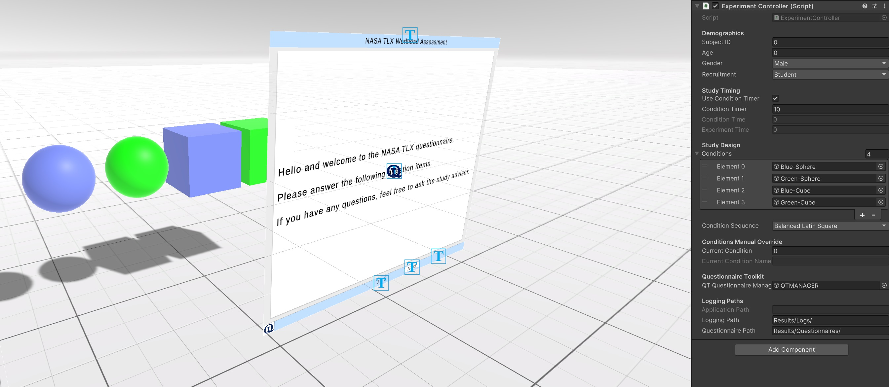

# Mixed Reality Lab Experiments

This repository contains a Unity project for running controlled experiments in desktop and VR environments. It provides a complete framework for managing experimental conditions, presenting questionnaires, collecting demographic data, handling timing, and logging events and frames.  
The core logic is implemented in the `ExperimentController` class. :contentReference[oaicite:0]{index=0}

The project is designed so that students can set up studies with minimal onboarding effort.

---

## Features

### Condition Management
Experiments consist of multiple conditions represented as Unity `GameObject`s.  
The controller can generate their order automatically using several sequence options:

- Balanced Latin Square  
- Latin Square  
- All permutations  
- Random shuffle (with or without seed)

Conditions are activated or hidden depending on the study flow.  
Manual navigation using the arrow keys is also supported.

---

### Questionnaire Integration
The project integrates the **QuestionnaireToolkit** to present surveys between conditions.  
Two elements work together:

- `QTManager` (questionnaire management)  
- `QTCanvas` (UI canvas for questionnaire display)

The canvas is automatically shown and hidden when questionnaires appear.

Input is supported via mouse (desktop) and Meta Quest controllers.

---

### Timing and Flow Control
The controller manages:

- Instruction text  
- Countdown before starting the study  
- Optional per-condition time limits  
- Automatic transition to the next condition or to questionnaires  
- Total experiment time and per-condition timing

---

### Logging
All data is stored as CSV files in the application's persistent data directory.

#### Event Log  
Records:

- Timestamps  
- Subject demographics  
- Current condition and sequence  
- Source and target of hits (mouse or VR controllers)  
- Optional custom values via Reflection (e.g., FPS)

#### Frame Log  
Optionally logs per-frame positional data of selected objects.

Both log types support extendable custom CSV fields.

---

### Demographics
Participant demographics can be configured in the Unity Inspector:

- Subject ID  
- Age  
- Gender  
- Recruitment category  

These values are automatically added to all logs.

---

## Project Structure

- `Assets/Experiment/Scenes`: VR and desktop experimental setups  
- `ExperimentController`: Main class handling conditions, questionnaires, and logging  
- `QuestionnaireToolkit`: Survey system integrated into the experiment flow

VR support is implemented via the Oculus OVR system (Meta Quest).

---

## Usage Notes

1. Set demographic information before running the experiment.  
2. Assign all conditions (Unity GameObjects) in the Inspector.  
3. Configure questionnaires inside the `QTManager`.  
4. Assign `QTCanvas` so questionnaires can be shown as an overlay.  
5. Logs and questionnaire results will be stored automatically in the persistent application folder. The exact path is printed to the Unity Console during runtime.

The system is modular: conditions, questionnaires, logging logic, and custom variables can be extended independently.

---

If you want, I can also generate:

- A Quick Start section for students  
- A flow diagram  
- A repository structure graphic  
- A short version for the GitHub project page  

Just let me know.

 
